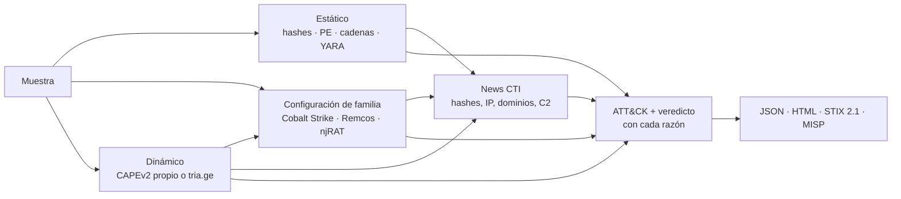

# malpipe

[](https://github.com/BlueShield-Ch4rl13/Malpipe/actions/workflows/ci.yml)
[](LICENSE)


**Pipeline automatizado de análisis de malware — estático + dinámico — con informe, configuración de familias, cruce con News CTI y exportación a STIX 2.1 y MISP.**

`malpipe` toma una muestra, la analiza sin ejecutarla (estático), opcionalmente la detona en un sandbox (tu propio **CAPEv2** o **tria.ge**), extrae la configuración de familias conocidas, cruza sus indicadores con [News CTI](https://cti.carlosvillalbalagos.com), mapea lo que ve a **MITRE ATT&CK** y da un veredicto que explica punto por punto.

Se usa de tres formas: la **línea de órdenes**, el **portal del navegador** ([box.carlosvillalbalagos.com](https://box.carlosvillalbalagos.com), sin servidor: la muestra no sale del navegador) y el **portal con servidor** (FastAPI, para tu red, con dinámico).

> Herramienta **defensiva** de DFIR / análisis de malware. Analiza muestras; no las crea.

---

## Arquitectura



**Estático (sin ejecutar):** hashes (MD5/SHA1/SHA256, imphash, ssdeep opcional), cabecera PE (secciones, entropía, imports sospechosos), cadenas e indicadores (IP, dominios, URL, correos) y YARA.

**Configuración de familias:** lee el formato de configuración de **Cobalt Strike** (tabla TLV con XOR 0x69/0x2e) y **Remcos** (recurso `SETTINGS` cifrado con RC4), y reconoce **njRAT** por su separador y sus cadenas (confianza media). Sale el C2, el puerto, la campaña, el mutex… Sobre una muestra empaquetada no hay configuración en claro: para eso está la que CAPEv2 saca del volcado de memoria, que malpipe recoge igual.

**Dinámico:** con **CAPEv2** la muestra se detona en tu infraestructura y la API devuelve puntuación, familia, firmas con su técnica ATT&CK, la red que vio y las configuraciones extraídas ([`docs/CAPE.md`](docs/CAPE.md)). Con **tria.ge**, puntuación, familia y firmas. VirusTotal no está implementado.

**News CTI:** busca en el feed público de [ScriptNewsCTI](https://github.com/BlueShield-Ch4rl13/ScriptNewsCTI) los hashes de la muestra, las IP, dominios y URL de sus cadenas, los C2 de su configuración y la red del sandbox. Un hash en el feed es malware conocido; una IP o un dominio, infraestructura que alguien ya ha visto atacar.

**Veredicto:** puntuación 0–100 con cada razón escrita (`+20 YARA: …`, `≥70 configuración de Cobalt Strike extraída`). Una familia identificada o un hash conocido fijan un mínimo, sumen lo que sumen las demás señales.

**Exportación:** JSON y HTML, y además **STIX 2.1** (bundle con la muestra, el análisis, indicadores con patrón, malware, técnicas ATT&CK y relaciones; IDs deterministas, TLP:AMBER) y **evento MISP** (atributos con `to_ids` solo si es malicioso, etiquetas de la galaxia de ATT&CK).

---

## Instalación

```bash
git clone https://github.com/BlueShield-Ch4rl13/Malpipe.git
cd Malpipe
pip install -r requirements.txt      # núcleo: pefile + requests
```

Opcional: `pip install yara-python` para YARA y `pip install ssdeep` (requiere `libfuzzy-dev`) para fuzzy hashing.

## Uso

```bash
# Solo estático (no necesita claves)
python -m malpipe muestra.exe --no-dynamic

# Estático + dinámico (CAPE_URL o TRIAGE_API_KEY) + News CTI + STIX y MISP
python -m malpipe muestra.exe -o reports/ --cti --stix --misp

# Un directorio entero, con un feed de News CTI local
python -m malpipe ./samples/ -o reports/ --cti-fichero iocs_latest.json
```

Cada análisis genera `reports/<sha256>.json` y `.html`, y con `--stix` y `--misp`, `.stix.json` y `.misp.json`.

```
[*] News CTI: 2279 indicadores (2026-10-25T06:00:00Z)
[*] Analizando: samples/beacon.bin
    veredicto : MALICIOSO (70/100)
    familia   : Cobalt Strike (cobaltstrike, confianza alta) C2: https://cdn.ejemplo-malo.test:443/jquery-3.3.1.min.js
    News CTI  : 1 coincidencia(s): cdn.ejemplo-malo.test
    informe   : reports/57cdf932789c.html
```

(La muestra es la configuración sintética de las pruebas, con un dominio `.test` inventado.)

### Con Docker (recomendado para la VM)

```bash
cp .env.example .env          # CAPE_URL/CAPE_TOKEN o TRIAGE_API_KEY
mkdir -p samples reports
docker compose run --rm malpipe /samples -o /reports --cti --stix --misp
```

## Configuración

Las claves se leen de variables de entorno (copia `.env.example` a `.env`, que está en `.gitignore`):

| Variable | Descripción |
|---|---|
| `CAPE_URL`, `CAPE_TOKEN` | Tu CAPEv2 (p. ej. `http://10.0.50.10:8000`) y su token de API — [`docs/CAPE.md`](docs/CAPE.md) |
| `CAPE_OPCIONES` | Opciones de la tarea, p. ej. `route=none` |
| `TRIAGE_API_KEY` | Clave de tria.ge |
| `MALPIPE_SANDBOX` | `auto` (CAPE si hay `CAPE_URL`, si no tria.ge), `cape` o `triage` |
| `MALPIPE_DYNAMIC_TIMEOUT` | Segundos de espera del informe del sandbox (300 por defecto) |
| `MALPIPE_CTI_URL` | Feed de News CTI (por defecto, el `iocs_latest.json` público de ScriptNewsCTI) |
| `MALPIPE_YARA_DIR` | Carpeta de reglas YARA (`rules/` por defecto) |

Sin sandbox, el pipeline avisa y ejecuta **solo estático**.

---

## Portal del navegador: box.carlosvillalbalagos.com

Para que **cualquiera, sin perfil técnico, compruebe un fichero** y reciba un veredicto con todo lo descubierto, **sin subirlo a ningún sitio**: el portal carga el propio paquete `malpipe` en **Pyodide** (Python en WebAssembly) y escanea con **YARA-X** (WebAssembly), las 97 reglas de `rules/`. El análisis es el mismo que el de la CLI (mismo código, mismo veredicto) salvo el dinámico, que necesitaría una clave visible para cualquiera.

- No hay servidor ni paso de compilación: la página está ya hecha en la **raíz del repositorio** ([`index.html`](index.html)) y Cloudflare la detecta y la sirve tal cual, igual que dfir. Misma línea visual que dfir.carlosvillalbalagos.com, con el naranja de malpipe.
- La muestra no sale del navegador. Lo único que se descarga es el motor (servido desde el propio portal) y, si se marca, el feed público de News CTI.
- CSP estricta: `script-src 'self' 'wasm-unsafe-eval'` (sin `unsafe-eval` ni `unsafe-inline`) y `connect-src` solo hacia el portal y el feed. Todo lo que sale de la muestra se pinta como texto, y los indicadores se muestran desactivados (`hxxp`, `[.]`).
- Descargas del informe en HTML, JSON, STIX 2.1 y MISP.

```bash
python tests/servidor_estatico.py  # http://127.0.0.1:8787, con las mismas cabeceras que en Cloudflare
npm ci && npm run box              # solo si cambias malpipe/ o rules/: rehace motor/ (~18 MB)
```

La página, los estilos y la interfaz (`index.html`, `estilo.css`, `app.js`, `motor.js`) se editan a mano. `motor/` (Pyodide, YARA-X y el código de malpipe empaquetado) lo genera `npm run box`; el CI falla si no está al día con `malpipe/` y `rules/`.

**Publicarlo** en el Worker `malpipe` de Cloudflare (`wrangler.jsonc` publica la raíz): en *Configuración → Compilación*, comando de compilación **vacío** y de despliegue `npx wrangler deploy`; en *Dominios y rutas*, el dominio personalizado `box.carlosvillalbalagos.com`. Cada push a `main` lo vuelve a publicar y las ramas no generan URL de vista previa (`preview_urls: false`). [`.assetsignore`](.assetsignore) deja fuera el proyecto Python: solo se publican la página y `motor/`.

Una vez publicado, las mismas pruebas de extremo a extremo contra el sitio real:

```bash
MALPIPE_PORTAL_URL=https://box.carlosvillalbalagos.com/ pytest tests/test_portal.py
```

## Portal con servidor (tu red, con dinámico)

El portal FastAPI de `webapp/` sirve el mismo motor por API y puede mandar las subidas a tu CAPE (`MALPIPE_WEB_DYNAMIC=1`). Es para tu red o para tu propia instancia, no para abrirlo a internet con tu CAPE detrás.

```bash
pip install -r requirements.txt -r requirements-web.txt
uvicorn webapp.server:app --host 127.0.0.1 --port 8000  #  ->  http://localhost:8000
# o con Docker:
docker compose up web
```

La muestra se analiza **en memoria**: el tamaño se corta mientras llega (antes de que FastAPI lea el cuerpo) y el umbral de volcado a disco de Starlette está por encima del límite de subida, así que no se escribe en `/tmp`.

| Endpoint | Descripción |
|---|---|
| `POST /api/analyze` | Sube un fichero → crea un trabajo, devuelve `job_id` |
| `GET /api/result/{job_id}` | Estado + informe (el estático llega al momento; el dinámico, cuando el sandbox termina) |
| `GET /api/result/{job_id}/stix` · `/misp` | El informe en STIX 2.1 o como evento MISP |
| `GET /api/config` | Config pública para el frontend (sitekey de Turnstile, tamaño máximo) |

Para exponerlo **sin abrir puertos** (el `docker-compose.yml` publica el 8000 solo en `127.0.0.1`), Cloudflare Tunnel:

```bash
cloudflared tunnel --url http://localhost:8000
```

Guardarraíles que trae y que hay que activar:

- **Nunca ejecuta en tu equipo** — la detonación ocurre en el sandbox.
- **No persiste ficheros** — se analizan en memoria. Pero con `MALPIPE_WEB_DYNAMIC=1` **cada muestra de un tercero va a tu sandbox** (y con tria.ge gratuito, el análisis es público). Por eso viene desactivado.
- **Rate-limit por IP** (`MALPIPE_RATE_MAX` / `MALPIPE_RATE_WINDOW`) y **límite de tamaño** (`MALPIPE_MAX_UPLOAD_MB`). La IP real (`CF-Connecting-IP`) solo se cree con `MALPIPE_BEHIND_CLOUDFLARE=1` y si la conexión llega del túnel.
- **Anti-bots** — Cloudflare Turnstile con `TURNSTILE_SITEKEY` y `TURNSTILE_SECRET`.
- **News CTI** — `MALPIPE_WEB_CTI=1` cruza cada análisis con el feed (descargado como mucho una vez por hora).

Variables (todas opcionales, ver `.env.example`): `MALPIPE_MAX_UPLOAD_MB` (30), `MALPIPE_RATE_MAX` (5), `MALPIPE_RATE_WINDOW` (600), `TURNSTILE_SITEKEY`, `TURNSTILE_SECRET`, `MALPIPE_WEB_DYNAMIC` (0), `MALPIPE_WEB_CTI` (0), `MALPIPE_BEHIND_CLOUDFLARE` (0).

---

## Cómo está probado

`pytest` en el CI, con dos jobs (`.github/workflows/ci.yml`):

| Qué | Cómo |
|---|---|
| Estático, YARA y veredicto | Hashes, IOCs, IP privadas fuera, una regla YARA rota no apaga las demás, todas las reglas compilan |
| Configuración de familias | Muestras **sintéticas** que reproducen cada formato (`tests/muestras_sinteticas.py`): una tabla TLV de Cobalt Strike con XOR 0x2e y 0x69, un PE con el recurso `SETTINGS` de Remcos cifrado con RC4, las cadenas de njRAT. Y que con datos aleatorios o con otra clave no sale nada |
| News CTI | Hash conocido → malicioso; `1.2.3.4` casa con `1.2.3.4:puerto`; el host de una URL casa con el dominio; el C2 de la configuración se cruza |
| STIX 2.1 y MISP | Validados con las librerías de referencia: `stix2.parse` en modo estricto y `pymisp.MISPEvent.load` |
| CAPEv2 | Respuestas simuladas que siguen su API v2 (crear tarea, estados, informe), tarea fallida y CAPE caído sin tumbar el estático |
| Portal con servidor | Subida y resultado, fichero vacío, Turnstile, corte por tamaño, `CF-Connecting-IP`, exportación STIX/MISP |
| **Portal del navegador** | Job aparte: rehace `motor/` y comprueba que sale idéntico al del repositorio; después abre el portal en **Chromium** con la CSP de producción (también se ha pasado contra `wrangler dev`, el motor de Cloudflare). Analiza la configuración sintética de Cobalt Strike (veredicto, C2, cruce con un feed de prueba, descargas JSON, STIX y MISP), EICAR (YARA-X, pestañas con teclado y vuelta a la portada), y un PE subido con HTML en sus cadenas que tiene que verse como texto. Falla con cualquier error de consola o violación de la CSP |

Lo que **no** está probado: el dinámico contra un CAPE o un tria.ge reales (necesitan una instancia o una clave) y los extractores con malware real. La guía de [`docs/CAPE.md`](docs/CAPE.md) termina con la comprobación contra tu CAPE.

---

## ⚠️ Seguridad

**Analizar malware requiere aislamiento.** El análisis estático no ejecuta la muestra; la detonación ocurre en el sandbox: tu CAPE en una VLAN sin ruta a nada ([`docs/CAPE.md`](docs/CAPE.md)) o tria.ge.

- Manipula muestras **solo dentro de una VM dedicada**, con snapshot y **sin acceso a tu red de confianza**.
- Las muestras y las salidas del sandbox **quedan fuera del repositorio** (ya están en `.gitignore`).
- Nunca subas muestras reales a un repo público.

---

## Estructura

```
malpipe/
├── malpipe/          # motor
│   ├── static/       # hashes, PE, strings/IOCs, YARA
│   ├── configs/      # configuración de Cobalt Strike, Remcos y njRAT
│   ├── dynamic/      # CAPEv2 y tria.ge
│   ├── enrich/       # ATT&CK, News CTI y veredicto
│   ├── export/       # STIX 2.1 y MISP
│   ├── report/       # informes JSON y HTML
│   ├── navegador.py  # entrada del portal del navegador (Pyodide)
│   ├── pipeline.py   # orquestador
│   └── __main__.py   # CLI
├── index.html · estilo.css · app.js · motor.js · 404.html · _headers   # portal box. (se edita a mano)
├── motor/            # Pyodide + YARA-X + malpipe empaquetado (lo genera npm run box)
├── scripts/box.mjs   # regenera motor/ desde malpipe/, rules/ y node_modules
├── webapp/           # portal con servidor (FastAPI)
├── rules/            # reglas YARA
├── docs/CAPE.md      # montar tu CAPEv2 en el laboratorio
├── tests/
├── wrangler.jsonc · .assetsignore   # el Worker "malpipe" publica la raíz (solo el portal)
├── package.json      # versiones fijadas de Pyodide y YARA-X
├── Dockerfile · docker-compose.yml
└── pyproject.toml
```

## Roadmap

- [x] Motor de detonación local CAPEv2 (host aislado) — [`docs/CAPE.md`](docs/CAPE.md)
- [x] Extracción de configuración de familias conocidas (Cobalt Strike, Remcos, njRAT, y las que extrae CAPE)
- [x] Export de IOCs a formato STIX 2.1 / MISP
- [x] Integración con [News CTI](https://cti.carlosvillalbalagos.com) para contrastar IOCs
- [x] Portal público sin servidor — [box.carlosvillalbalagos.com](https://box.carlosvillalbalagos.com)
- [ ] Más familias en los extractores (AsyncRAT, AgentTesla) y probarlos con muestras reales del laboratorio
- [ ] Enviar a ResponseLab el veredicto de una muestra de un incidente (`/v1/<cliente>/evidencias/malpipe`) desde la CLI

## Licencia

MIT
